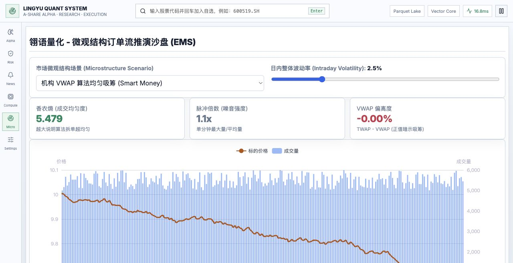

# Lingo Quant Demo | 翎语量化系统



> 封面为本项目网页的实际截图，展示 Micro 微观结构沙盘。图中价格和成交量为场景模拟数据，不是实时行情或策略业绩。

面向 A 股的量化投研终端原型，包含分钟行情采集、Parquet 数据湖、微观结构因子、风格中性化、LightGBM 研究、回测及流式前端。

本仓库是研究与交互演示项目，**不是生产交易系统，不承诺收益，不构成投资建议**。

## 功能与数据边界

| 模块 | 当前实现与限制 |
| --- | --- |
| Alpha 工作台 | 市场全景、实时因子矩阵、去重的 Alpha Stream；支持面板拖动、缩放与全屏。 |
| 行情接入 | 后端通过本机 FFD MCP 配置查询行情快照，当前配置为 67 只代表股，不是全市场扫描。 |
| 市场全景 | 尝试查询行业资金流；接口不可用时退回代表股分组聚合，不能视为全行业资金净流入。 |
| 因子矩阵 | FFD 快照通道中的 Alpha Z、胜率、成交熵等包含启发式代理值，不是训练模型的真实预测或校准概率。 |
| Micro | 240 分钟价格与成交量模拟、VWAP 偏离、脉冲倍数与香农熵可视化。 |
| Risk | 风格雷达、行业偏离可视化，当前前端风险数据为演示数据。 |
| Compute | WebSocket 状态与推理日志；实际含义取决于后端报文，不能仅凭连接成功认定 AI 模型已运行。 |
| News | AkShare 快讯和 OpenAI 兼容 LLM 分析，需要自行配置 API Key、可用接口和模型。 |
| Python 研究 | 异步分钟采集、Hive 分区存储、微观因子、Barra 风格中性化、回测及 VWAP 执行模拟。 |

行情时间以数据源返回的快照时间为准；休市、数据源限流、授权到期或断网时，不会因此获得新的实时数据。顶部固定的延迟文案也不是实测性能。

## 快速预览

已保留当前网页的预构建版本，无需安装 Node.js。从项目根目录运行：

```bash
python3 -m http.server 5174 --bind 127.0.0.1 --directory frontend/dist-static
```

打开 <http://127.0.0.1:5174/>，点击左侧 **Micro** 可进入封面中的独立沙盘。图表通过 jsDelivr 加载 ECharts，需要网络连接；Alpha 和 News 数据需要后端及对应数据服务。

`dist-static` 是用于快速预览的已有构建快照；修改 React 源码后请使用下面的 Vite 开发流程，不会自动更新这个快照。`frontend/standalone/` 是早期独立演示页，不代表当前工作台。

## 本地开发

### Python 环境

当前依赖包含较早的 NumPy 版本约束，建议使用 Python 3.10 创建隔离环境：

```bash
python3.10 -m venv .venv
source .venv/bin/activate
python -m pip install --upgrade pip
python -m pip install -e ".[dev]"
python -m pip install aiohttp lightgbm fastapi "uvicorn[standard]"
```

LightGBM 在部分 macOS 环境下还需要可用的 OpenMP 运行库。

启动 API：

```bash
python -m uvicorn api.server:app --host 127.0.0.1 --port 8000
```

- 健康检查：`http://127.0.0.1:8000/health`
- 行情流：`ws://127.0.0.1:8000/ws/inference`
- 舆情流：`ws://127.0.0.1:8000/ws/news`

健康检查仅表示 API 已启动，不表示外部行情授权、LLM 或模型数据可用。服务尚无完整认证与访问控制，请仅绑定本机，不要直接暴露到公网。

### 数据与密钥

行情通道读取本机 `~/.ffd/mcp-config.json`，需单独安装并授权 FFD。此配置及密钥不随仓库发布，请不要提交它们。

舆情服务读取 `OPENAI_API_KEY`、`OPENAI_BASE_URL`、`OPENAI_MODEL` 环境变量。默认兼容服务地址为 `https://api.deepseek.com/v1`、模型为 `deepseek-chat`；请按实际服务商修改。可在本机终端隐藏输入 Key，不要写入代码：

```bash
read -s OPENAI_API_KEY
export OPENAI_API_KEY
export OPENAI_BASE_URL="https://api.deepseek.com/v1"
export OPENAI_MODEL="deepseek-chat"
```

应在同一终端中启动后端。外部数据服务的授权、费用、延迟、覆盖范围与可用性由服务商决定。

### React / Vite

本地 Vite 的 Node.js 要求为 `^20.19.0 || >=22.12.0`：

```bash
cd frontend
npm ci
npm run dev -- --host 127.0.0.1 --port 5174
```

前端当前连接本机 `127.0.0.1:8000`。如 5174 已被快速预览占用，请先停止预览服务器，或为 Vite 选择其他端口。

## 测试与研究脚本

```bash
python -m pytest -q
python examples/run_research_loop.py
python examples/run_microstructure_backtest.py
python examples/run_live_inference.py --help
```

部分研究脚本在找不到历史数据时会使用 demo 样本。示例收益、夏普比率、成交成本与模型分数不构成真实业绩证明；接入真实数据后仍需验证交易日历、复权、交易限制、样本外评估及交易成本。

## 目录

```text
api/server.py                       FastAPI 与 WebSocket 服务
lingyu_quant/                       数据、因子、风险、ML 与执行研究模块
examples/                           离线研究及实时推理入口
tests/                              Python 测试
frontend/src/                       React 终端与各视图组件
frontend/dist-static/               可直接运行的预构建网页
docs/images/cover.jpg               README 网页封面截图
```

本地行情、研究输出、依赖目录、环境文件和备份通过 `.gitignore` 排除。
